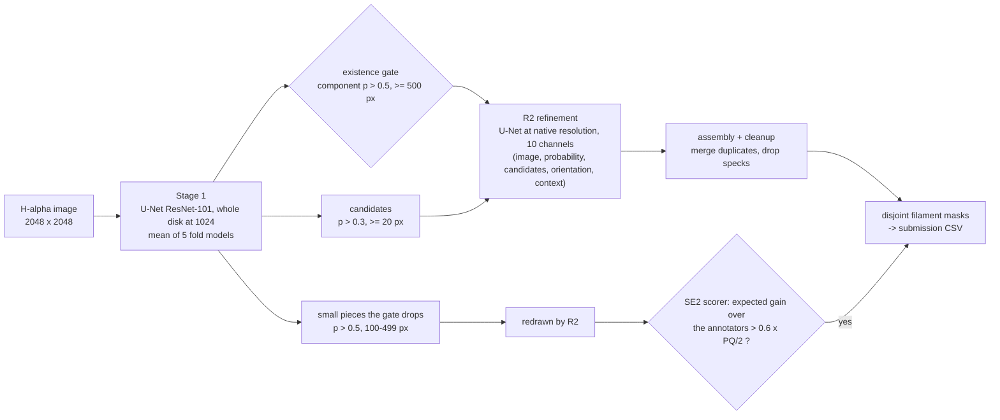
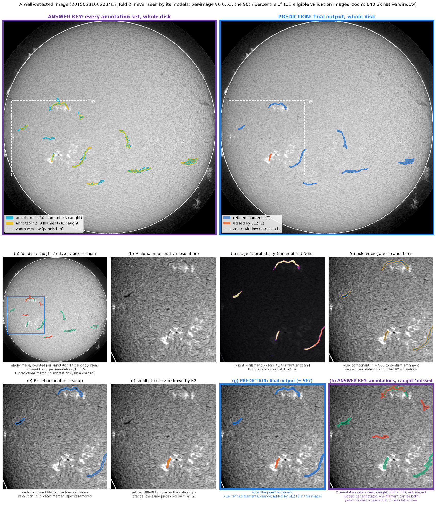
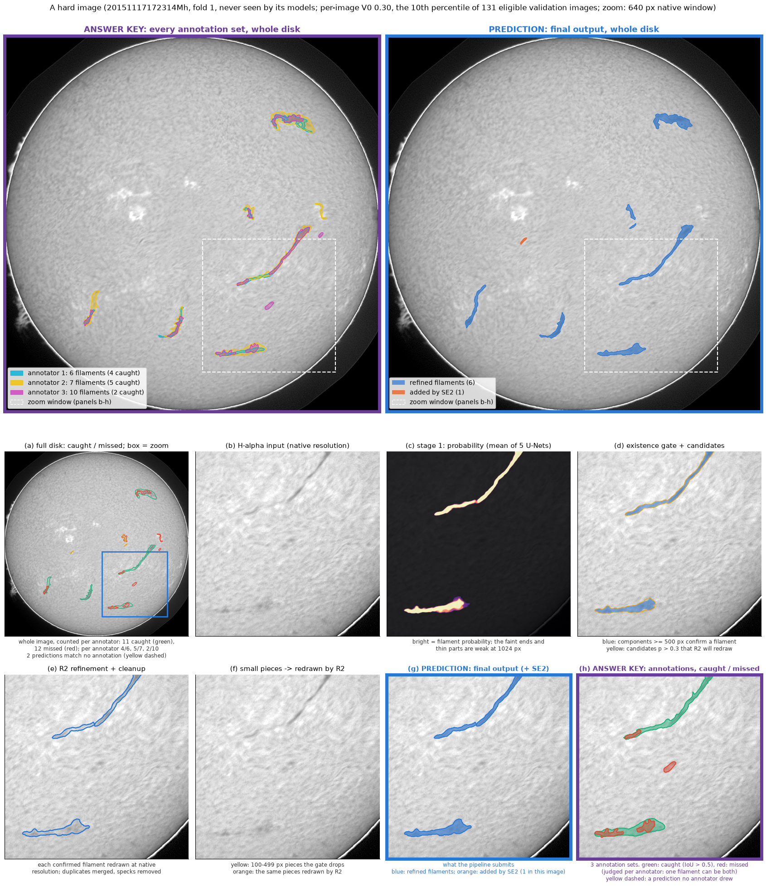
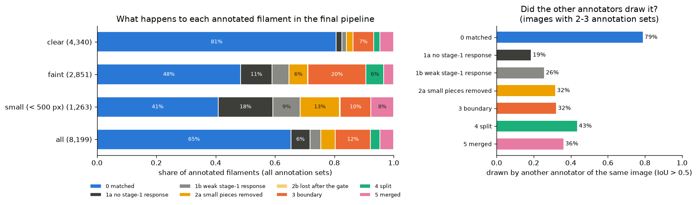
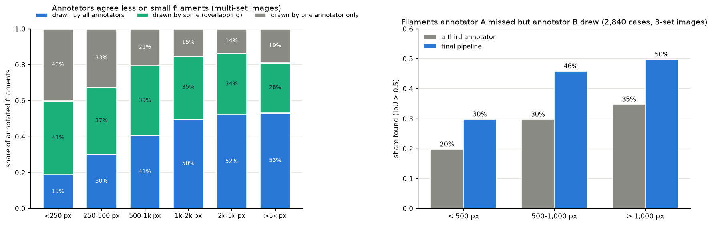
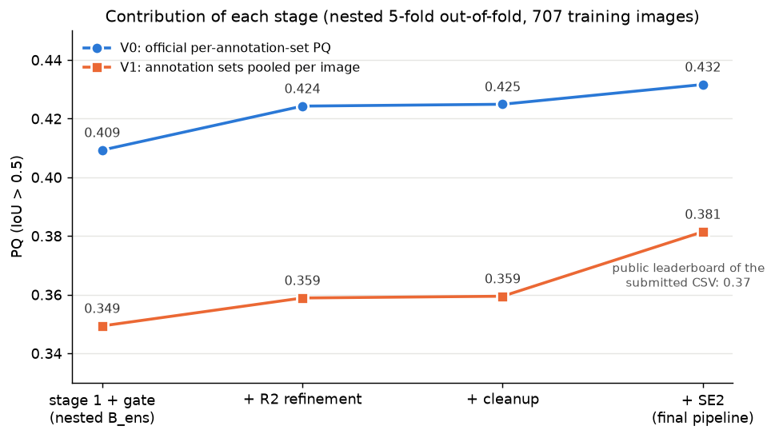
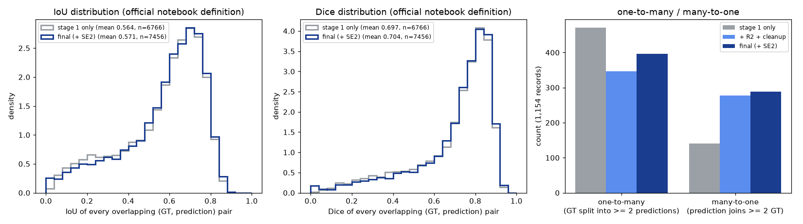
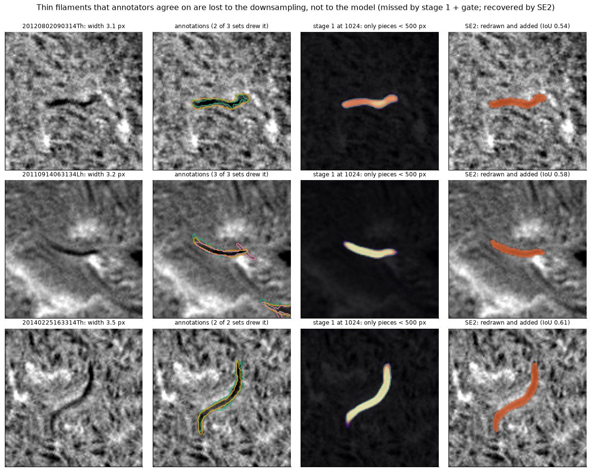
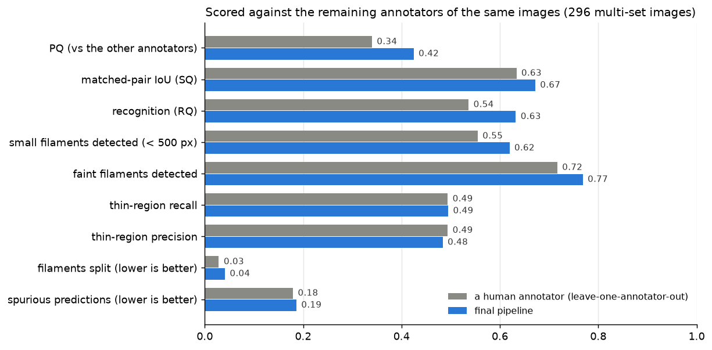
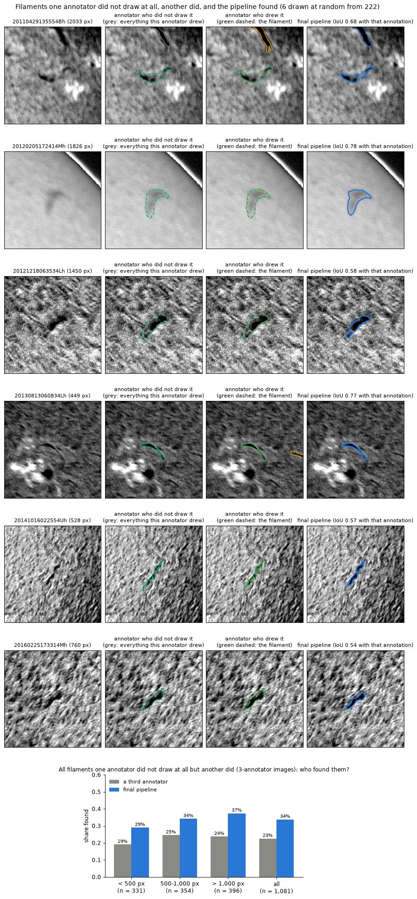

# Solar Filament Segmentation Challenge 2026

Reproducible instance segmentation of solar filaments in GONG full-disk H-alpha images
([Kaggle: filament-segmentation-2026](https://www.kaggle.com/competitions/filament-segmentation-2026)).

## Overview

Solar filaments are dark, elongated, often faint structures; each training image carries 1–3 independent annotation
sets that disagree considerably (two annotators of the same image agree with PQ 0.34). The pipeline has three
learned stages:

1. **Stage 1** — a U-Net (ResNet-101 encoder) sees the whole solar disk at 1024² and finds the filaments.
2. **R2 (refinement)** — a second U-Net redraws each found filament at the native 2048² resolution, recovering the
   faint ends and thin parts that the downsampling of stage 1 loses.
3. **SE2 (small-fragment selection)** — thin filaments that the downsampling breaks into small pieces are redrawn by
   R2; a small CNN predicts each piece's score over the annotators, and pieces above a threshold set for the
   leaderboard-type score are added.

The annotation sets are never fused: the models learn from every set, and SE2 scores each piece by its gain averaged
over the annotators.



### Output of each stage

Two validation images that the models never saw, picked by a rule rather than by eye: among the 131 images with
2–3 annotation sets, on average at least 6 annotated filaments per set and at least one SE2 addition, the image
closest to the 90th percentile of per-image PQ (V0) and the one closest to the 10th percentile. The zoom is the
640 px window with the most annotated pixels; panel (a) shows the whole image.

**A well-detected image** (per-image PQ 0.53; caught per annotator: 6 of 10 and 8 of 9):



**A hard image** (per-image PQ 0.30; caught per annotator: 4 of 6, 5 of 7 and 2 of 10):



**Top row, whole disk.** Left, purple frame: the answer key, every annotation set in its own colour (legend:
annotator 1–3, how many filaments each drew and how many of them the pipeline caught). Right, blue frame: the final
output (blue: refined filaments; orange: added by SE2). The white dashed box is the zoom window of panels (b)–(h).

**Panels (a)–(h).** (b) input; (c) stage 1 finds the filaments on the whole disk, but faint ends and thin parts are
weak at 1024 px; (d) components of at least 500 px confirm a filament, and every candidate touching one is (e)
redrawn by R2 at native resolution; (f) thin filaments that broke into small pieces are redrawn as well, and (g) SE2
adds those whose predicted score over the annotators exceeds its threshold. **(g), blue frame: the prediction**
(what is submitted). **(h), purple frame: the answer key** coloured by the result: **green = caught**, **red =
missed**; yellow dashed = a prediction that no annotator drew. Panel (a) shows the same colours on the whole disk.

**How caught and missed are counted.** As in the official metric, each annotator's drawing is scored separately: an
annotated filament is caught when one prediction overlaps it with IoU > 0.5. A filament drawn by three annotators
therefore counts three times, and an annotator who draws one filament as several pieces adds one record per piece.
In the hard image the third annotator drew 10 pieces where the others drew 6 and 7. Of its 12 missed records, 6 are
pieces or a different extent of a filament that is caught for another annotator, 3 overlap a prediction with IoU
0.38–0.45 (just below 0.5), and 3 have no prediction at all.

## Results

| | Value |
|---|---|
| Public leaderboard (PQ) | **0.37** |
| Cross-validation PQ, official per-annotation-set definition ("V0") | **0.432** |
| Cross-validation PQ, annotation sets of an image pooled ("V1") | 0.381 |
| Mean Dice (official definition) | 0.673 |
| Inference time, one GPU | 3.1–3.4 s per image |

The two cross-validation numbers are nested 5-fold out-of-fold on the 707 training images and differ only in
aggregation: V0 scores every annotation set as a separate record, as the organisers' self-evaluation notebook does;
V1 pools the sets of an image, which is how the leaderboard appears to score (the public scores of our earlier
submissions matched V1 within rounding; for this CSV, 0.381 out of fold and 0.37 public).

| Stage | V0 | V1 |
|---|---|---|
| Stage 1 | 0.409 | 0.349 |
| + R2 and cleanup | 0.425 | 0.359 |
| + SE2 (final) | 0.432 | 0.381 |

Details, the rubric distributions (Dice, IoU, one-to-many, many-to-one), morphology and the comparison with the
annotators: `docs/results.md`.

## What the analysis shows

**Where the pipeline loses annotated filaments.** Every annotated filament of every annotation set was traced through
the pipeline (`scripts/miss_decomposition.py`):



- Clearly visible filaments are matched 81 % of the time; faint ones 48 %, small ones (< 500 px) 41 %.
- The filaments that stage 1 does not respond to at all (median probability 0.003) were also drawn by another
  annotator of the same image in only 19 % of cases, against 79 % for the filaments the pipeline matches: they lie at
  the edge of what the annotators draw (the MAGFiLO protocol leaves out filaments that are too small or too faint).
- Large faint filaments that the pipeline splits are the misses that other annotators drew most often (43 %).

**Annotators disagree most on small filaments.** In images with several annotation sets, all annotators drew 19 % of
the filaments under 250 px but about half of those over 1,000 px; this is why SE2 decides by the expected score over
the annotators rather than by a fixed size.



**Each stage contributes, and the rubric quantities move with it.**





**Thin filaments are lost to the downsampling, not to the model.** Filaments that two or three annotators drew and
that stage 1 sees only as pieces under 500 px are redrawn and added by SE2:



**Agreement with the annotators.** Each annotator left out in turn and scored against the remaining sets, and the
pipeline scored the same way (296 multi-set images). This measures agreement with the other annotators, not accuracy
against the Sun; see `docs/results.md` §6 for what it does and does not show.



**Filaments one annotator did not draw.** In the 3-annotator images, 1,081 filaments drawn by one annotator overlap
nothing that a second annotator drew. The third annotator drew 23 % of them and the pipeline found 34 % (under
500 px: 19 % vs 29 %). Six of the 222 that the pipeline found, drawn at random (`scripts/fig_annotator_cases.py`):



This is again agreement with other annotators: the pipeline also outputs 10 % more filaments than an annotator
draws, and structures that no annotator drew cannot be judged this way.

## Quick start: reproduce the submission

Requires **Python 3.12 or newer** (the pinned numpy 2.5 and scipy 1.18 need it; tested with Python 3.13 on Linux).

```bash
git clone https://github.com/paul77ms/filament-segmentation-2026.git && cd filament-segmentation-2026
python3 -m venv .venv && . .venv/bin/activate && pip install -r requirements.txt
unzip filament-segmentation-2026.zip       # competition data -> MAGFiLO_1.0_Kaggle_2026/{train,test}/
jupyter nbconvert --to notebook --execute notebooks/reproduce_submission.ipynb --output reproduce_submission.executed.ipynb
```

**Data in another folder.** The notebook finds `MAGFiLO_1.0_Kaggle_2026/` in the repository root, next to the
repository, in the current folder or in a Kaggle notebook's input (`/kaggle/input/filament-segmentation-2026`).
Anywhere else: `export FILSEG_DATA=/path/to/MAGFiLO_1.0_Kaggle_2026` before running, or set `DATA` in the notebook's
first code cell. Only the test images are needed to reproduce the CSV; the final evaluation section also uses the
training data and skips its live check (with a message) if it is absent.

The notebook is stored with the outputs of a run of exactly these commands (fresh clone and environment, RTX A6000,
2026-11-09), so it can be read on GitHub without running it. It loads the weights stored in `weights/` (no training),
runs the whole pipeline on the 180 test images,
writes `outputs/submission_r2b0_se2.csv` and compares it with the submitted CSV in `reference/`. On an NVIDIA RTX
A6000 the output is byte-identical (about 10 minutes); on a GPU without bf16 or on CPU (about 14 s per image) it
runs in fp32 and the notebook reports the agreement with the reference within tolerances fixed in advance. Other ways to run it, CPU behaviour and training from scratch:
`docs/reproducibility.md`.

## Method in brief

- **Why stage 1 sees the whole disk.** Filaments are long and end faintly; deciding where one ends needs context
  across hundreds of pixels. A filament exists where stage 1 finds a component of at least 500 px.
- **Why R2.** At 1024² a 3.5 px wide filament becomes 2 px wide and faint ends fall below the threshold. R2 redraws
  only filaments that stage 1 confirmed (it never invents one), at native resolution, guided by the local orientation
  of the filament. It adds +0.015 V0. A cleanup then removes detached specks (the MAGFiLO quality rule).
- **Why SE2.** Thin filaments that annotators agree on often break into pieces under 500 px. Small filaments are also
  where annotators disagree most, so SE2 predicts each redrawn piece's gain averaged over the annotators. The
  threshold (0.6 x the break-even of the per-set metric) was chosen for the leaderboard-type score V1, which counts a
  filament that any one annotator drew; it keeps filaments that only some annotators drew. It adds +0.0067 V0 and
  +0.022 V1, and also more predictions that no annotator drew (1,074 -> 1,533).

Every stage was validated nested out-of-fold against a rule registered before the result. Two were adopted by
decisions taken after seeing a result, R2 and the SE2 threshold (at which SE2 does not pass its registered rule);
both are stated in `docs/validation.md`. Full rationale: `docs/methodology.md`.

## Repository structure

```
notebooks/   reproduce_submission.ipynb: the whole pipeline, from the stored weights to the submission CSV
src/         self-contained inference (filseg_infer*.py, CLI) and the training/evaluation library (filseg/)
weights/     the 7 model checkpoints, stored as parts < 50 MB with SHA-256 manifests
configs/     final_pipeline.json: every constant and how it was set
reference/   the submitted CSV
docs/        methodology, results, validation, annotator handling, reproducibility
scripts/     training, validation and analysis entry points (entry_points.md lists them in order)
records/     logs of the original training and validation runs; registry.csv holds each stage's rule and result
tests/       metric, RLE, scorer and nested-design tests
```

## Documentation

| Document | Contents |
|---|---|
| `docs/methodology.md` | each step, its settings, and the data or domain fact behind it |
| `docs/results.md` | all results, figures, the comparison with the annotators, limitations |
| `docs/validation.md` | cross-validation design, scorers, how each stage was adopted, leakage checks |
| `docs/annotators.md` | how the 1–3 annotation sets are used |
| `docs/reproducibility.md` | reproduction options, packages, training from scratch, hardware and time |

**Main limitations:** more predictions that no annotator drew (SE2's threshold favours the leaderboard-type score;
they are unannotated candidates that need independent review), faint filaments without a stage-1 response, splits of
large faint filaments, filaments at 60–70° longitude, and smoothly drawn fine structure such as barbs
(`docs/results.md`).

## Licence and references

- Code: MIT License (`LICENSE`): anyone, including the organisers, may use, copy, modify and distribute it free of
  charge. The competition data is not redistributed.
- Ahmadzadeh et al., MAGFiLO dataset, *Scientific Data* 11:1031 (2024), doi:10.1038/s41597-024-03876-y.
- Kirillov et al., Panoptic Segmentation, CVPR 2019. Ronneberger et al., U-Net, MICCAI 2015. He et al., ResNet,
  CVPR 2016.
