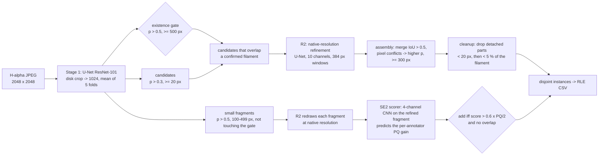
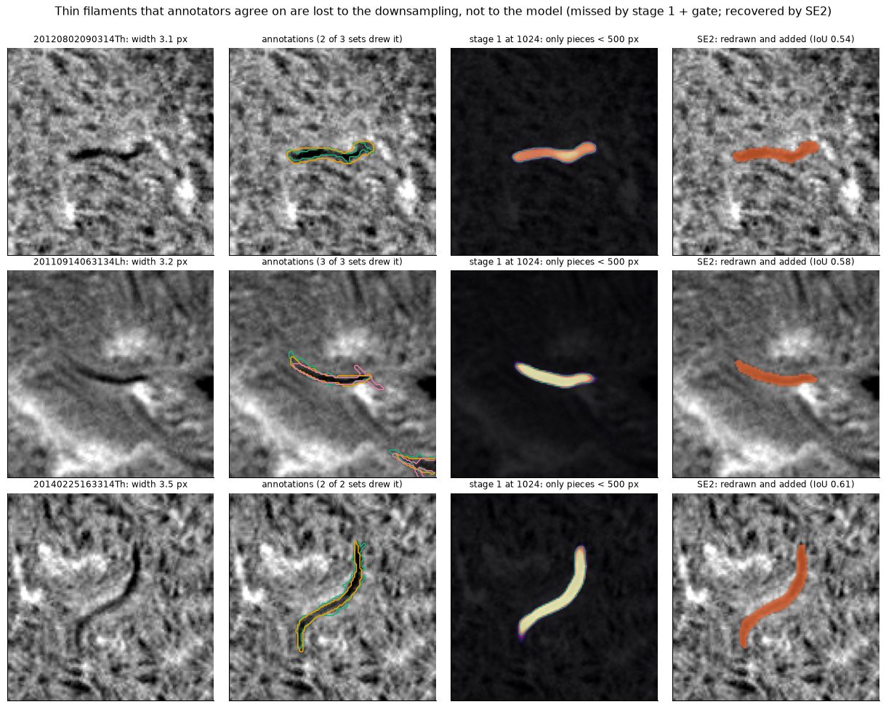
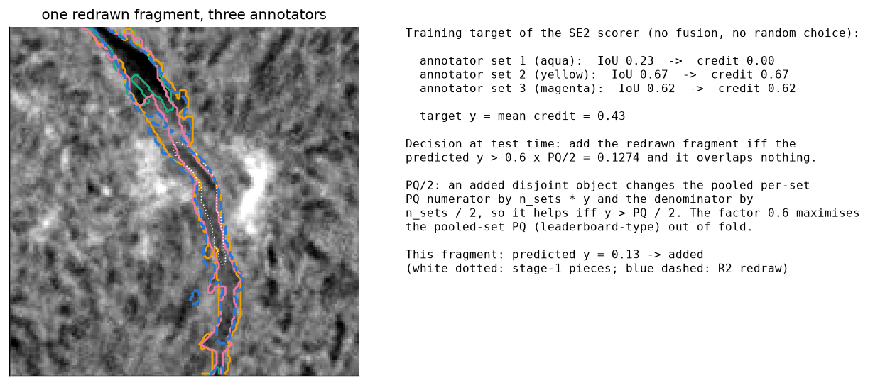
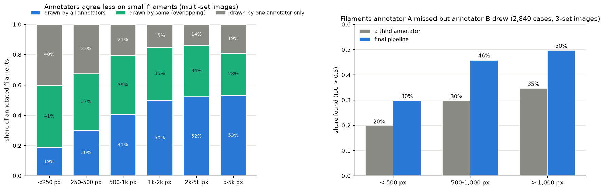

# Methodology: what the pipeline does and why

This document describes every step of the final pipeline and the data or domain fact behind it, with the measurement
that confirmed it. All numbers are nested out-of-fold (707 training images, 1,154 annotation-set records) unless
stated otherwise.

**Names used in this repository**
- **Stage 1**: the whole-disk U-Net (5 fold models; the checkpoints are called `b0_fold*.pt`, "b0" being the name of
  the stage-1 training recipe).
- **R2**: the native-resolution refinement model (`r2_final.pt`).
- **SE2**: the small-fragment selection stage (`se2_scorer.pt`).
- **V0**: Panoptic Quality as the organisers' self-evaluation notebook computes it, every annotation set of an image
  scored as a separate record. **V1**: all annotation sets of an image pooled and matched one-to-one; our
  approximation of the leaderboard scorer.

## 0. The pipeline at a glance

| Step | What it does | Main settings |
|---|---|---|
| Pre-processing | crop the solar-disk window, resize | `[120:1928]^2` -> 1024² (INTER_AREA), `(x/255 - 0.30)/0.22` |
| Stage 1 | filament probability | U-Net with ResNet-101 encoder (ImageNet initialisation), 1 channel; 5 fold models, each rounded to float16, then the mean |
| Existence gate | which filaments exist | 8-connected components of p > 0.5 with >= 500 px |
| Candidates | what R2 refines | components of the uint8 map p > 0.3 with >= 20 px that overlap the gate |
| R2 | native-resolution extent | U-Net ResNet-101, 10 channels: image, candidate, probability, other candidates, orientation cos2θ/sin2θ (structure tensor of the probability), and a 4x context (1536 px -> 384) of image, probability, candidate and others; mean over the windows covering the candidate |
| Assembly | instances | masks p > 0.5; merge masks with IoU > 0.5; a pixel claimed twice goes to the higher probability; drop < 300 px |
| Cleanup | structural continuity | in a multi-part filament, drop parts < 20 px, then parts < 5 % of the filament (the MAGFiLO QA rule); the largest part is kept |
| SE2 | small filaments | candidates overlapping a component of p > 0.5 with 100–499 px that does not touch the gate; refined by R2 and assembled (>= 100 px); 96² native crop, 4 channels (image, probability, refined fragment, >= 500 px components); ResNet-101 stem + layer1 + layer2 (5.9 MB); add iff the score > 0.12744 and there is no overlap |

`configs/final_pipeline.json` lists every constant and how it was set.

**Models and training**

| Model | Architecture | Input | Parameters | Weights |
|---|---|---|---|---|
| Stage 1 (5 fold models) | U-Net, ResNet-101 encoder (ImageNet initialisation) | 1 channel, 1024² | 51.5 M each | `weights/b0_fold{0..4}.pt` |
| R2 | the same U-Net with a 10-channel first convolution | 10 channels, 384² native windows | 51.5 M | `weights/r2_final.pt` |
| SE2 scorer | ResNet-101 stem + layer1 + layer2, global average pooling, linear | 4 channels, 96² native crop | 1.5 M | `weights/se2_scorer.pt` |

- Stage 1: BCE + soft Dice, AdamW (lr 3e-4, weight decay 1e-4), batch 4, 60 epochs, cosine schedule with warm-up,
  the last epoch is used; augmentation: flips, rotation ±15°, gamma / gain / offset, occasional blur and noise.
- R2: BCE + soft Dice, batch 16, 30 epochs, trained on the windows of the out-of-fold stage-1 maps of all 707 images.
- SE2 scorer: trained on out-of-fold redrawn fragments of all training images (`docs/validation.md`).

## 1. Facts about the data and the domain that the design relies on

| Fact | Number | Source |
|---|---|---|
| GONG H-alpha full-disk images from 6 sites (file suffix L, C, M, B, T, U), 2011–2022, 2048² grayscale JPEG | the solar disk lies inside `[120:1928]²`; nothing outside it is annotated | competition data, `docs/validation.md` |
| Filaments are dark, elongated absorption features (cool, dense plasma held above polarity inversion lines). Many are thin | thin filaments are 3–4 px wide at native resolution (`fig_thin_recovery`) | images, annotations |
| Filament size spans two orders of magnitude | annotated areas: < 250 px 2 %, 250–500 px 13 %, 500–2,000 px 54 %, > 2,000 px 31 % (8,199 filaments) | training annotations |
| Every image has 1–3 annotation sets drawn independently; the dataset keeps the disagreement on purpose | two annotators of the same image agree with PQ 0.34; matched-filament IoU median 0.63 | `docs/annotators.md`, Ahmadzadeh et al. 2024 |
| Annotators agree less on small filaments | drawn by all annotators: 19 % of filaments < 250 px, 50–53 % of filaments > 1,000 px | `fig_beyond_human` (left) |
| Each annotation is one polygon; the MAGFiLO quality check removed detached islands under 5 % of a filament | 8,199 of 8,199 annotations are single polygons | dataset paper, training annotations |
| Annotation protocol: filaments beyond ±70° longitude are not drawn | 3 of 8,199 annotations lie beyond ±70° | training annotations |
| The Sun rotates: a surface point stays well visible for about 11–13 days, and a long-lived filament returns after about 27 days | the share of filaments re-found in a later image falls from 0.80 (< 1 h) to about 0 at 10–14 days | `scripts/make_splits.py` analysis |
| The 6 sites observe the same Sun at nearly the same time | 13 image pairs taken 20–40 s apart at different sites | file names |
| The metric is PQ at IoU > 0.5; each annotation set is scored as a separate record | an unmatched prediction costs 1/2 in the PQ denominator of every set of its image | organisers' self-evaluation notebook |

## 2. Component by component

### 2.1 Input window and resolution (stage 1 at 1024²)

**What.** Crop the disk window `[120:1928]²` and resize it to 1024².

**Why.**
- Filaments are long, curved objects whose ends are faint. Deciding where one filament ends and the next begins needs
  context across hundreds of pixels, so stage 1 sees the whole disk at once.
- A ResNet-101 U-Net at 1024² fits one GPU with 14 GB at batch size 4.

**The price, and why later stages exist.**
- The resize factor is 0.566, so a 3.5 px wide filament becomes 2 px wide.
- Such filaments break into pieces at 1024² although stage 1 sees them. The filaments that two or more annotators drew
  but the pipeline missed have a median stage-1 probability of 0.95 (nested out-of-fold stage 1).
- Every later stage that works at native resolution (R2 and SE2) exists to recover what this resize loses.

### 2.2 Stage 1: U-Net with a ResNet-101 encoder, 5 fold models

**What.**
- A semantic U-Net, initialised with ImageNet weights, trained with BCE + soft Dice for 60 epochs.
- The last epoch is used, with no early stopping on the validation fold.
- The test-time model is the mean of the 5 fold models, so every model used on the test set has an out-of-fold
  record.

**Why a semantic model plus connected components.**
- Each annotated filament is one polygon, so the connected components of a probability map follow the instance
  convention. Where neighbouring filaments touch, R2 and the assembly separate them (2.4, 2.5).
- The encoder starts from ImageNet weights (torchvision ResNet-101); no other external weights or data are used.

**Augmentation.**
- Used: horizontal and vertical flips, rotation within ±15°, brightness and contrast (gamma 0.8–1.25, gain
  0.85–1.15, offset ±0.06), and occasional blur and noise.
- **No 90° rotations.** GONG images are oriented north up, and the ±70° longitude protocol applies to the east and
  west limbs. A 90° rotation would move that "not annotated" band to the poles. Flips keep both conventions.
- **No CLAHE or histogram equalisation.** The disk background of the JPEGs is already flat, and a per-pixel
  intensity transform does not change which pixels are darker than others; the gamma augmentation above makes the
  model insensitive to such transforms.
- **Image quality is not a driver.** Once filament size and contrast are controlled for, sharpness has no measurable
  effect on detection (p = 0.69). Test-image quality cannot be told apart from training-image quality (classifier
  AUC 0.49).

### 2.3 Existence gate: p > 0.5 and at least 500 px

**What.** A filament exists where a connected component of p > 0.5 has at least 500 px.

**Why.**
- PQ charges every unmatched prediction 1/2 in the denominator of every annotation set of the image.
- Small components are mostly noise, or filaments that only some annotators drew.
- With no size rule at all, the model would gain 502 matches but add 4,478 false-positive records.

**Evidence.**
- 0.5 and 500 px were chosen by nested CV (`scripts/tune_post.py`).
- Nested automatic tuning of all seven post-processing constants gains +0.0003 [-0.0015, +0.0023], so the constants
  sit on a plateau (`fig_constants`).
- The gate is the only sensitive constant: 600 px gives V0 -0.010.

**The gate discards real small filaments.** This loss is handled by SE2 (2.7), not by lowering the gate. A 300 px
gate trades V0 for V1 (-0.005 / +0.004).

### 2.4 R2: native-resolution refinement of each confirmed filament

**What.**
- Every candidate (p > 0.3, at least 20 px) that overlaps a confirmed filament is redrawn by a second U-Net.
- The U-Net works on 384² native windows with 10 channels:
  - the image;
  - this candidate;
  - the probability;
  - the other candidates;
  - the orientation cos 2θ / sin 2θ;
  - a 4x wider context of image, probability, candidate and others.

**Why.**
- **The second-largest loss is partial extent** (27 % of false negatives). A filament's faint ends and gaps drop below
  p = 0.5 and break it into pieces.
- **Existence is decided only by the gate.** A candidate must overlap a confirmed filament, so R2 never invents a new
  object; it only decides how far a confirmed one extends. No morphological closing is used.
- **The orientation channels** give the local axis direction, along which a filament continues.
- **The "other candidates" channel** shows where the neighbours are, so that two filaments are not drawn as one.
- **The wide context** covers filaments longer than a window.
- **Native resolution** keeps the 3–4 px wide parts that 1024² loses.

**Evidence.**
- V0 +0.0150 [+0.0104, +0.0197]; all 5 folds positive; 426 images better and 253 worse.
- R2 trades splits for joins. With the cleanup (2.6), one-to-many falls from 471 to 346 and many-to-one rises from
  141 to 277 relative to stage 1. Both are reported.
- R2 failed two of its pre-registered thin-region conditions and was adopted by a stated post-hoc decision
  (`docs/validation.md`).

### 2.5 Assembly

**What.**
- Masks of p > 0.5 with IoU > 0.5 are merged: two candidates of one filament both redraw the whole filament.
- A pixel claimed by two filaments goes to the higher probability.
- Filaments under 300 px are dropped.

**Why.** The submission must be disjoint instances.

**Evidence.** Every constant here is on the same plateau (2.3).

### 2.6 Cleanup: drop detached parts under 20 px, then under 5 % of the filament

**What.** In a multi-part filament, remove detached parts under 20 px, then parts under 5 % of the filament. The
largest part is always kept.

**Why.**
- Each annotation is one polygon, and MAGFiLO's own quality check removed islands under 5 % of the filament's area.
- A specked mask is neither the annotation convention nor a continuous structure.

**Evidence.**
- PQ is neutral: V0 +0.0006, V1 +0.0006.
- Multi-part filaments 27.6 % → 14.7 %; many-to-one 364 → 277; one-to-many 451 → 346.
- It is kept for structural continuity and visual quality, not for score.

### 2.7 SE2: small filaments, redrawn at native resolution, then judged

**What.**
- Fragments: the candidates that overlap a small component (p > 0.5, 100–499 px) not touching the gate.
- R2 redraws each fragment and the result is assembled (at least 100 px).
- A small CNN (ResNet-101 stem + layer1 + layer2, 4 channels, 96² native crop) scores each redrawn fragment.
- A fragment is added iff its score exceeds 0.12744 and it overlaps no existing filament.

**Why redraw before judging.**
- The fragments are pieces of thin filaments that broke apart at 1024² (2.1).
- Judged as raw pieces, their IoU with the annotation is below 0.5 even when the filament is real.
- Redrawn by R2, the same filament reaches IoU 0.54–0.61 (figure above).

**Why these candidates.**
- Annotated filaments under 100 px are 6 of 8,199.
- Fragments that touch the gate are parts of filaments R2 already redraws.

**Why these channels.**
- The scorer sees the image, the probability, the redrawn fragment and the confirmed filaments.
- A fragment next to a confirmed filament is often a piece of it.

**What the score predicts.**
- Small filaments are where annotators disagree: 40 % of filaments under 250 px were drawn by one annotator only.
- The target is therefore the mean over the image's annotation sets of (IoU with that set's best filament if > 0.5,
  else 0).
- A filament drawn by one annotator in three earns a third of the credit and is never taught as background.

**Why add iff the score exceeds PQ/2.**
- Adding a disjoint prediction to an image with n sets raises the PQ denominator by 1/2 for every set:
  - a match turns a false negative into a true positive (+1 - 1/2);
  - otherwise it adds a false positive (+1/2).
- The numerator rises by the IoU of each match.
- So the pooled V0 rises exactly when the mean per-set gain y exceeds PQ/2 (`tests/test_small_exist.py` checks this
  with the real evaluator). PQ/2 = 0.2124.

**Why 0.6 x PQ/2.**
- PQ/2 is the break-even of the per-set metric V0, where the score is exactly the gain. The leaderboard pools the
  annotation sets of an image (V1): there a fragment that any one annotator drew is a full match, while its score
  counts it only for the annotators who drew it (a third, for one annotator of three). Under V1 the break-even on
  this score is therefore lower than PQ/2.
- The multiplier m was chosen by V1 on a pre-defined grid {0.6, 0.8, 1.0, 1.25, 1.5}: for each outer fold, on the
  other four folds (m = 0.6 in four folds, 0.8 in one); at test time m = 0.6, the V1 maximum over all 707 images.
  Threshold 0.6 x 0.2124 = 0.12744 (`records/se2/analysis/threshold_v1.json`).
- The price is more predictions that no annotator drew (below). The criterion was changed from V0 to V1 after an
  exploratory sweep had been seen, and the final threshold does not pass SE2's registered rule; `docs/validation.md`
  states both.

**Evidence** (final pipeline vs the same pipeline without any small-filament stage, nested;
`records/se2/analysis/se2_vs_no_small_stage.json`):

| | without small stage | final |
|---|---|---|
| V0 | 0.4249 | 0.4316 (+0.0067 [+0.0028, +0.0106], 5/5 folds) |
| V1 | 0.3595 | 0.3814 (+0.0220 [+0.0179, +0.0259], 5/5 folds) |
| missed annotations (set records) | 1,968 | 1,226 |
| small-filament detection vs the annotators (LOAO; a human: .555) | .295 | .619 |
| 32 fixed review cases, V0 | .383 | .393 |
| predictions matching no annotation set | 1,074 | 1,533 |
| many-to-one / one-to-many | 277 / 346 | 289 / 397 |

- **What the additions are.** SE2 adds 928 predictions; 469 match at least one annotation set. Of the 459 that match
  none (`records/se2/analysis/added.csv`):
  - 66 % lie more than 10 px from any annotation, 68 % of them in single-annotator images: small dark structures that
    the image's annotator did not draw (unannotated candidates that need independent review, not confirmed filaments);
  - 30 % overlap an annotated filament with IoU 0.1–0.5 (the right structure, but the mask covers only part of it).
- **Robustness.** V1 rises at all 6 sites and in all 4 periods (2011–2022); V0 in all 4 periods and at 5 of the 6
  sites (site B: -0.0001).

### 2.8 What the pipeline deliberately does not do

- **No closing and no invented branches.** Morphological closing could join separate filaments, and invented
  branches could draw structure that is not visible. R2 only redraws candidates that the model itself detected.
- **No hole filling.** 11 % of annotated filaments contain small enclosed pockets (fold 0).
- **No limb rule.** The model has learned the ±70° protocol itself: it predicts nothing beyond it. It also misses 71 %
  of the filaments at 60–70°, which is a remaining weakness.
- **No annotation metadata in training.** Spine and chirality are not used. The spine is used only to check the
  predicted axis: median 2.11 px from the annotator's spine, vs 2.05 px between two annotators.
- **No external data or external weights** other than ImageNet initialisation.

## 3. The annotators: never fused

**What.**
- Stage 1 and R2 draw one annotation set per visit (seeded). The expected loss is then the loss averaged over the
  image's annotators.
- The SE2 target averages the per-set gain.
- Evaluation keeps every set separate (V0), pools them (V1), and scores each annotator against the others (LOAO).

**Why.**
- The dataset keeps disagreement on purpose. The official metric scores each set separately, so the best single
  submission maximises the expected score over the annotators.

**Why not fuse them.** A union rewards covering what *any* annotator drew, which joins neighbouring filaments and
widens them; an intersection deletes the faint and small filaments that only some annotators drew; with two sets a
majority vote is one of the two (`docs/annotators.md`).

**Outcome against the annotators** (agreement, not accuracy; see `docs/results.md` §6 for the limits).
- In 3-annotator images, among filaments one annotator did not draw but another did, a third annotator found 30.6 %
  and the pipeline 45.0 %.
- By size: under 500 px 19.7 % vs 29.7 %; over 1,000 px 34.7 % vs 49.7 % (figure, right). The pipeline also outputs
  10 % more filaments than an annotator draws, which can account for part of this.
- The pipeline was trained on all annotators of the training images, so it predicts something close to their typical
  drawing; this measures agreement with the remaining annotators, not accuracy against the true Sun.

## 4. Validation design

**14-day groups.**
- Images less than 14 days apart share a fold (57 groups).
- **Physics.** A filament stays well visible for about 11–13 days as the Sun rotates.
- **Data.** The share of filaments re-found in a later image falls to about 0 at 10–14 days.
- **Feasibility.** A larger window (16 days or more) merges the dense 2011–2017 period into groups larger than a fold.
- **Cross-site twins.** Images of the same Sun taken seconds apart at different sites stay in the same fold.

**Why not leave-one-site-out or leave-one-year-out.**
- The test set has the same site and year mix as training, and 98.9 % of test images lie within 14 days of a training
  image. The 14-day grouping is therefore stricter than the test condition.
- Holding out a site would also put same-instant twins from other sites into training.
- Instead, site and period are balanced across folds, and the gain of each stage is checked per site and per period.
  For SE2, V1 is positive at all 6 sites and in all 4 periods, V0 at 5 of 6 sites and in all 4 periods.

**Nested validation of the stacked stages.**
- R2 and the SE2 scorer are trained on stage-1 outputs, so they were validated with inner models that never saw the
  evaluated fold.
- This takes 10 inner stage-1 models, 5 R2n models and 20 inner R2 models (`docs/validation.md`).

**Rules before results.**
- Every stage was judged by a rule registered before the result (`records/registry.csv`).
- The two post-hoc decisions, R2 and the SE2 threshold, are stated in `docs/validation.md`.
