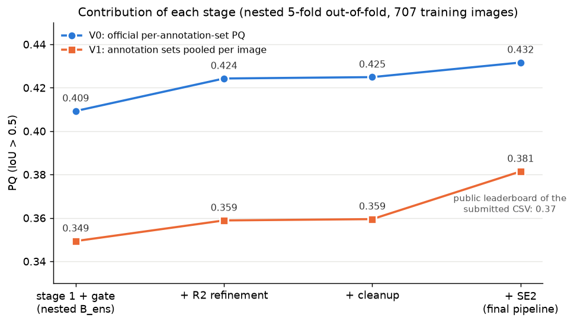
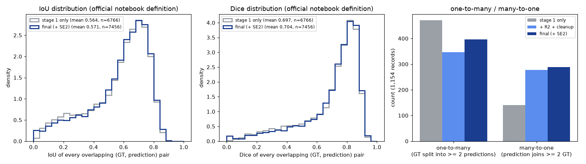
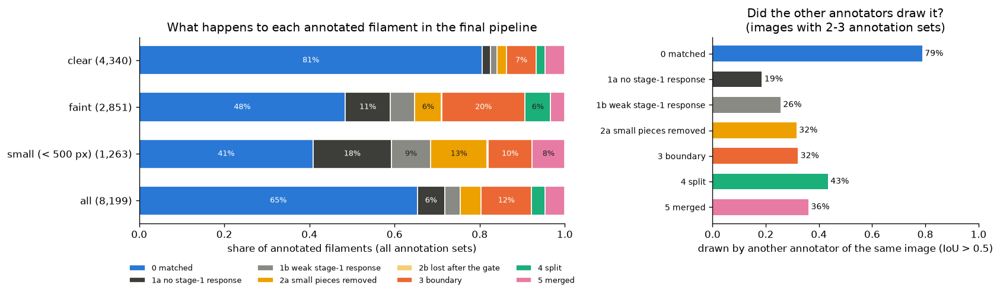
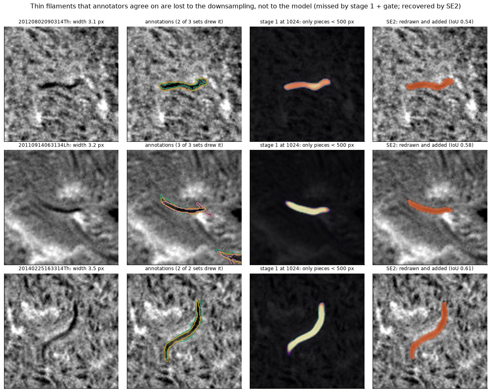
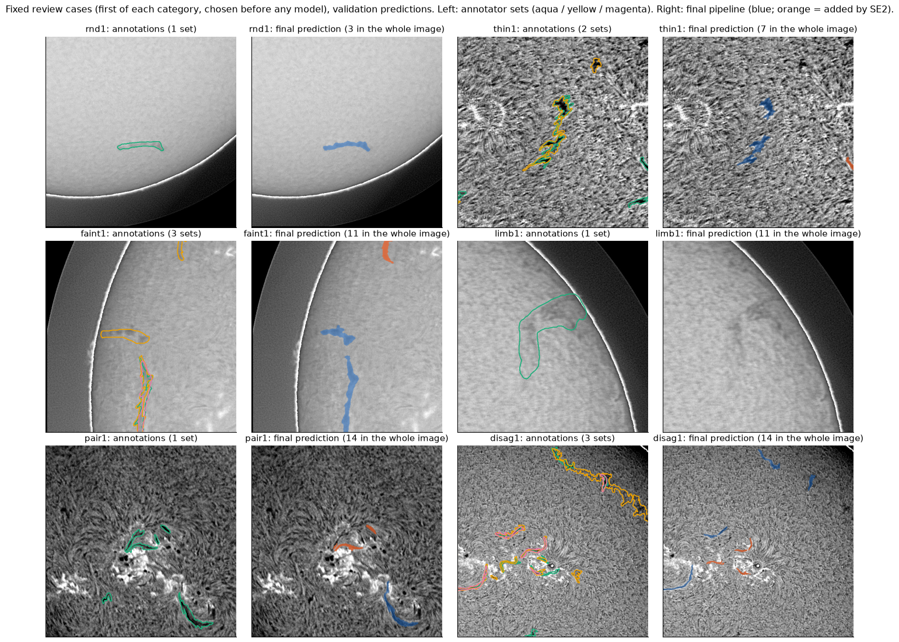
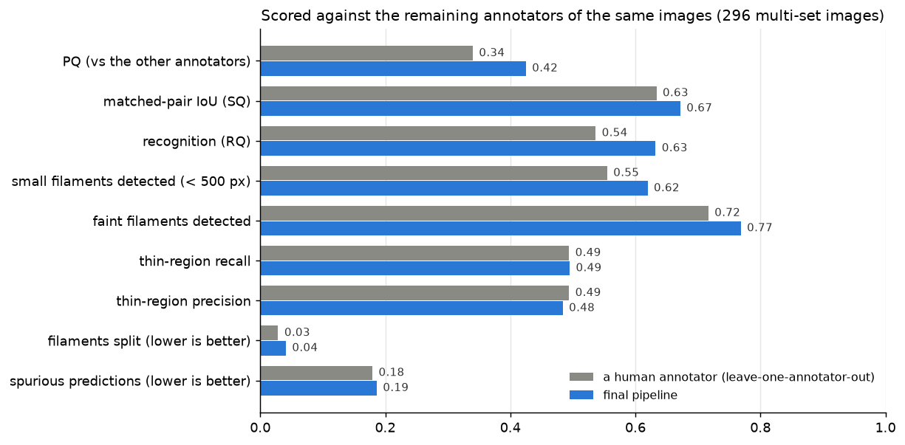
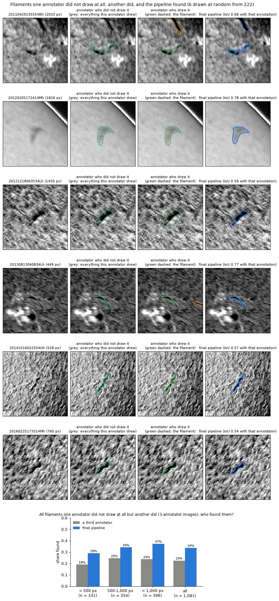
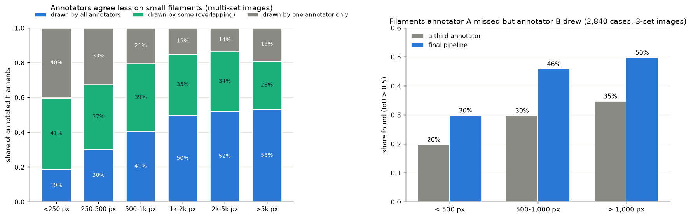

# Results

All validation numbers are nested 5-fold out-of-fold on the 707 training images (1,154 annotation-set records); the
protocol is in `docs/validation.md`. The test labels are hidden; the only test number is the public leaderboard.

## 1. The three PQ numbers and how they differ

| Number | Value | What it is |
|---|---|---|
| Public leaderboard | 0.37 | the organisers' hidden scorer on the public part of the 180 test images |
| V0, per annotation set | 0.432 | the organisers' self-evaluation notebook on our out-of-fold predictions: every annotation set of an image is a separate record, so an image with 3 sets counts 3 times |
| V1, sets pooled | 0.381 | all annotation sets of an image pooled into one ground truth, one-to-one matching; our approximation of the leaderboard scorer (the public scores of our earlier submissions matched it within rounding; for this CSV it is 0.011 above the public score) |

They differ in aggregation, not in the predictions: V0 rewards a prediction once per annotator who drew it, V1 once
per image. The same predictions therefore score lower under V1.

## 2. Contribution of each stage

| | V0 | V1 |
|---|---|---|
| stage 1 + existence gate | 0.409 | 0.349 |
| + R2 refinement | 0.424 | 0.359 |
| + cleanup | 0.425 | 0.359 |
| **+ SE2 = final pipeline** | **0.432** | **0.381** |

- **R2.** V0 +0.015 [+0.010, +0.020] (95 % file bootstrap) against the same stage 1, positive in all 5 folds.
- **Cleanup.** Neutral on PQ (+0.0006); multi-part filaments 27.6 % -> 14.7 %.
- **SE2** (against the same pipeline without a small-filament stage): V0 +0.0067 [+0.0028, +0.0106] and
  V1 +0.0220 [+0.0179, +0.0259]; both positive in all 5 folds; V1 positive at all 6 sites and in all 4 periods
  (2011–2022), V0 at 5 of 6 sites (site B -0.0001) and in all 4 periods; missed annotations 1,968 -> 1,226; of the
  928 predictions it adds, 469 match at least one annotator, and predictions that match no annotation set rise from
  1,074 to 1,533 (`records/se2/analysis/se2_vs_no_small_stage.json`). Its threshold was chosen for V1; it costs V0
  relative to a threshold chosen for V0 (`docs/validation.md`).

## 3. Quantitative items of the judging rubric

Official self-evaluation definitions, 1,154 records (`scripts/rubric_metrics.py`):

| | stage 1 + gate | + R2 + cleanup | final (+ SE2) |
|---|---|---|---|
| mean Dice (union masks per record) | 0.664 | 0.665 | 0.673 |
| mean IoU / Dice of overlapping pairs | 0.564 / 0.697 | 0.574 / 0.706 | 0.571 / 0.704 |
| GT filaments not touched by any prediction | 1,994 | 1,945 | 1,195 |
| predictions touching no GT filament | 830 | 728 | 1,422 |
| one-to-many (GT split) / many-to-one (GT joined) | 471 / 141 | 346 / 277 | 397 / 289 |

R2 trades splits for joins (the sum is 612 for stage 1 and 623 after R2 and cleanup); SE2 raises both (686). All are
reported.

## 4. Where annotated filaments are lost

Every annotated filament of every annotation set traced through the pipeline (`scripts/miss_decomposition.py`,
8,199 records; summary in `records/report_analyses/miss_summary.json`):

| Outcome | Records | Drawn by another annotator too (multi-set images) |
|---|---|---|
| matched (IoU > 0.5) | 5,358 (65.3 %) | 79 % |
| no stage-1 response (p < 0.1; median 0.003) | 526 | 19 % |
| weak stage-1 response (p 0.1–0.5) | 297 | 26 % |
| seen only as pieces < 500 px, not added | 399 | 32 % |
| lost after the gate | 6 | – |
| boundary (overlap, IoU <= 0.5) | 971 | 32 % |
| split into several predictions | 264 | 43 % |
| merged with another filament | 378 | 36 % |

By visibility: clear filaments are matched 81 % of the time, faint ones 48 %, small ones (< 500 px) 41 %.

## 5. Morphology

For matched filaments, the central axis of the predicted mask (longest path of its skeleton) lies a median 2.11 px
from the annotator's hand-drawn spine, with 83 % of the spine within 3 px. Between two annotators' spines of the same
filament: 2.05 px, 83 % (`scripts/axis_analysis.py`). The spine is used for this analysis only, never for training.

## 6. Comparison with the annotators (and its limits)

Each annotator is left out in turn and scored against the remaining annotation sets of the same images (296
multi-set images); the pipeline is scored in exactly the same way.

- Scored against the remaining annotators, the pipeline reaches PQ 0.42, a left-out annotator 0.34. It detects more
  of the small filaments (0.62 vs 0.55), but more of its predictions match no remaining annotator (0.186 vs 0.179),
  its thin-region precision is lower (0.484 vs 0.494), it splits more often (0.041 vs 0.029), and it outputs 10 %
  more filaments than an annotator draws (count ratio 1.10).
- In images with three annotators, among the 2,840 filaments one annotator did not draw but another did, a third
  annotator found 30.6 % and the pipeline 45.0 % (under 500 px: 19.7 % vs 29.7 %; over 1,000 px: 34.7 % vs 49.7 %;
  `scripts/human_missed.py`). Part of this difference can come from the larger number of predictions.

Restricted to filaments that the left-out annotator did not draw at all (no shared pixel; 1,081 in the 3-annotator
images), a third annotator found 23 % and the pipeline 34 %; under 500 px 19 % vs 29 %
(`scripts/fig_annotator_cases.py`, `records/report_analyses/annotator_cases.json`). Six of the 222 that the pipeline
found, drawn at random:

**What this does and does not show.** These numbers measure agreement with the other annotators of the same images
under this leave-one-annotator-out protocol. The pipeline was trained on all annotators of the training images, so
it predicts something close to their typical drawing; a single annotator has an individual style. The comparison
does not show that the pipeline is more accurate than a solar physicist, and visible structures that no annotator
drew cannot be judged by it at all (they need independent expert review).

## 7. Limitations

- **Predictions no annotator drew.** SE2's threshold was set for the leaderboard-type score, so the pipeline keeps
  small structures that only some annotators would draw: 1,533 of its 5,267 validation predictions match no annotation
  set (1,074 without SE2), and against the remaining annotators its spurious rate is slightly above a human's (0.186
  vs 0.179). Such structures are unannotated candidates that need independent review, not confirmed filaments.
- **Small and faint filaments.** Many filaments that stage 1 misses entirely have almost no response in its probability map,
  and whether a small or faint structure is annotated at all depends strongly on the annotator (the MAGFiLO protocol
  leaves out filaments that are too small or too faint).
- **Splits and joins.** Large faint filaments that appear as aligned pieces are sometimes output as several
  instances; R2 trades splits for joins.
- **Near the limb.** The pipeline follows the annotation convention (nothing beyond ±70° longitude) but misses 71 % of
  the filaments at 60–70°.
- **Fine structure.** Barbs and parts narrower than about 3 px are drawn smoothly; 1024² stage-1 input halves their
  width before R2 redraws the extent at native resolution.
- **One interpretation per filament.** A submission is one segmentation; where annotators disagree on extent or on
  one filament vs two, the pipeline outputs the interpretation with the highest expected per-annotator score.
